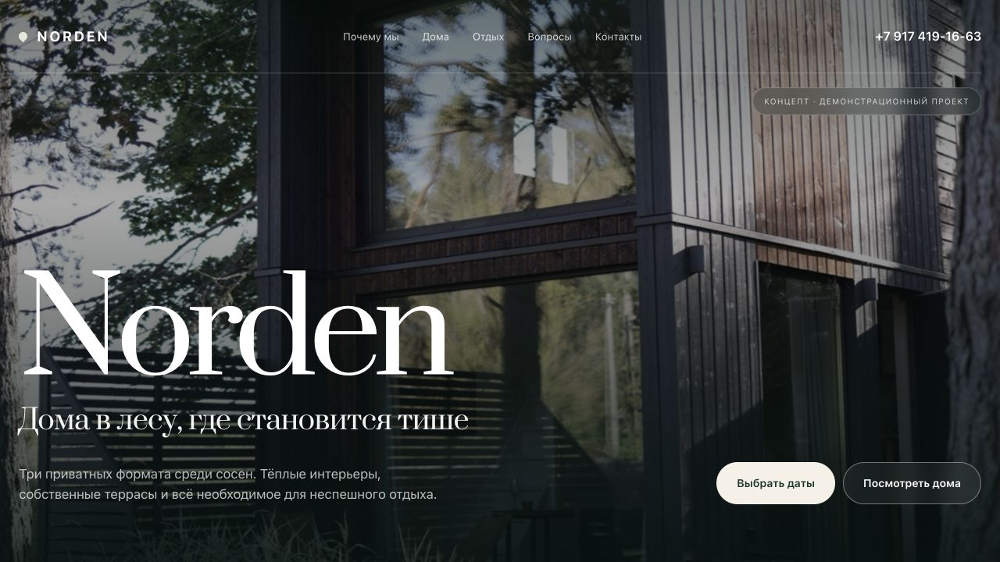

# NORDEN

**Сайт загородного ретрита**

[Открыть демо](https://vagapov-studio.netlify.app/portfolio/norden/site/)

## Задача

Передать атмосферу загородного отдыха и помочь гостю выбрать дом, услуги и даты поездки.

## Возможности

- Каталог домов с фотографиями и переключением вариантов.
- Подача преимуществ и сценариев отдыха.
- Дополнительные услуги, отзывы и ответы на вопросы.
- Интерактивный сценарий выбора дома и дат.
- Адаптивная композиция и плавное появление разделов.

## Реализация

HTML, CSS и JavaScript. Природная палитра и крупные фотографии помогают раскрыть место, а структура ведёт к выбору дома.

Проектирование сценариев, дизайн интерфейса, адаптация и разработка — Vagapov Studio.

## Статус

Демонстрационный проект. Сценарий бронирования показывает интерфейс, но не подтверждает реальные заезды и не принимает оплату.

## Связаться

[Обсудить проект в Telegram](https://t.me/vagapov_studio) · [Написать на почту](mailto:vagapov.studio.pro@gmail.com) · [Сайт студии](https://vagapov-studio.netlify.app/)

---

Публичный кейс: описание, изображения и ссылки на демонстрацию. Исходный код проекта закрыт.
